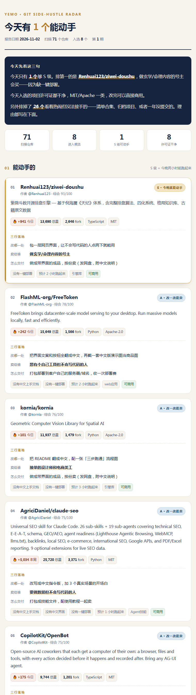

# 夜秣git副业雷达 · Yemo Git Radar

> GitHub 每天冒几百个项目，你翻完二十个，脑子是涨的，钱包是空的。
> 这个工具只干一件事：**把「什么火」翻译成「今晚动哪一行」。**

一个给 AI Agent（WorkBuddy / Claude Code / Cursor 等）用的技能包。
每天自动扫一遍 GitHub 上**涨星最快**和**近 30 天新冒头**的高星项目，
然后不按星数排，按 **「能不能变成钱」** 排，只留今晚能动手的那几个。



---

## 它和涨星榜有什么不一样

| | trending / awesome 合集 | 本雷达 |
|---|---|---|
| 排序依据 | 星数、涨星速度 | **能不能变成钱**（六维加权） |
| 输出 | 一个链接列表 | 每个项目三行落地：改哪一处、卖给谁、怎么交付 |
| 许可证 | 不标 | 单独占 25 分，是最大单项 |
| 落选项目 | 不出现 | 明确列出「为什么排掉」，这一半才是价值 |
| 语言 | 英文原样 | 中文报告 + 中文解说 |

一句话：**不告诉你什么火，告诉你今晚动哪一行。**

---

## 每个项目强制三行

这是整套东西的分界线。给不出三行的项目，再火也出不了报告。

| 行 | 要写成什么样 | 反例 |
|---|---|---|
| **改哪一处** | 今晚就能动手的一个具体动作 | ~~优化用户体验~~ |
| **卖给谁** | 具体到平台上一搜能搜到一群人 | ~~想做 AI 的人~~ |
| **怎么交付** | 收一次还是收月费，网盘还是部署到客户机器 | ~~看情况~~ |

真实例子（某天排第一的项目）：

```
改哪一处：包一层网页界面，让不会写代码的人点两下就能用
卖给谁：  做玄学命理内容的号主
怎么交付：做成带界面的成品，按份卖，发网盘附中文说明
```

---

## 评分模型

满分 100，六维 + 一道硬淘汰 + 一个可正可负的调节项。

| 维度 | 分值 | 判据 |
|---|---|---|
| 可商用 | 25 | MIT/Apache/BSD=25；MPL/LGPL=15；GPL/AGPL=5；无许可证=8 |
| 上手成本 | 20 | 按语言给基准分，有 docker/homepage 加分 |
| 中文友好 | 15 | desc 是中文 +8，README 汉字占比 >8% 再 +7 |
| 需求真实 | 20 | issue/star 比当「有人在真用」的代理指标 |
| 交付轻重 | 10 | 仓库体积越小越容易打包 |
| 时效红利 | 10 | 近 30 天新建 = 10 分，越老越低 |
| **可接手度** | ± | 要 GPU/集群 −12；framework/sdk −6；大厂主导 −8；对上具体行业 **+8** |

**为什么许可证占 25 分**：这是唯一一个踩了会真出事的维度。
星数低只是没赚到，许可证错是要赔的。

**硬淘汰（直接不进报告）**：

- 已归档 / 一年多没提交
- 星数 < 50（需求没被验证）
- 纯 awesome 清单 / 合集（跑不起来，交不出去）
- 涉及绕过平台限制、破解、破甲、盗版

---

## 怎么用

把 `SKILL.md` 和 `scripts/` 一起丢进你的 Agent 技能目录，然后说一句：

```
跑一下今天的副业雷达
```

### 直接跑脚本

```bash
pip install requests

python scripts/radar.py run                          # 出今天的报告
python scripts/radar.py run --days 7 --top 15        # 只看一周内新冒头的，多列几个
python scripts/radar.py run --min-stars 1000         # 只要星多的
python scripts/radar.py run --no-trending            # 不看 trending，只扫新建项目
python scripts/radar.py run --out ~/Desktop          # 报告放桌面
```

报告落在 `data/reports/Git副业雷达_YYYY-MM-DD.html`，双击就能看，手机上也能看。

### 两步走（推荐，带 AI 解说）

```bash
python scripts/radar.py fetch --days 30 --top 8   # 第一步：只抓数据
# 让 Agent 读 data/last_picks.json，补中文人话 / 审三行 / 补风险
python scripts/radar.py render                    # 第二步：出报告
```

规则只认关键词，认不出「这个项目其实没人愿意付钱」。这一步就是让 Agent 把它认出来。

### 每天自动

跟 Agent 说：

```
每天早上 8 点跑一次夜秣git副业雷达，报告放到桌面。
```

---

## Token（不给会很慢）

按优先级自动找 `GH_TOKEN` → `GITHUB_TOKEN` → `GITHUB_PAT` 环境变量 → 最后从本机 git 凭证取。

匿名请求每小时只有 60 次，扫不完三十多个项目。**配一个 token，一次省五分钟。**

---

## 关于那个推荐位

第一次出报告时，底部会带一张技能介绍卡。
**从第二次起不再出现** —— 每天推同一张卡是骚扰，不是推广。

计数存在 `data/state.json` 的 `promo_shown` 里，想重看就改回 0。

---

## 文件结构

```
yemo-git-radar/
├── SKILL.md                  ← 技能本体，Agent 读这个
├── scripts/
│   ├── radar.py              ← 主引擎：fetch / render / run
│   ├── gh_client.py          ← 数据源（trending HTML + Search API + README）
│   ├── scorer.py             ← 六维评分、形态分类、缺口识别、合规拦截
│   ├── pitch.py              ← 三行落地（买家 / 动作 / 交付）
│   ├── report.py             ← HTML 渲染
│   └── promo.py              ← 推荐位计数
├── templates/report.html     ← 报告视觉，改这里就改长相
├── references/
│   ├── 变现评分方法论.md      ← 每个阈值的来由
│   └── 数据源与已知坑.md      ← 抓取层踩过的坑
└── data/                     ← 运行时产物（已 gitignore）
```

---

## 依赖

只要 `requests`。没有数据库，没有第三方服务，没有 API key 也能跑（只是慢）。
Python 3.8+。

---

## 已知坑

抓取层踩过的坑都写在 [`references/数据源与已知坑.md`](references/数据源与已知坑.md)，
包括 GitHub trending 改版导致的解析失效、同一天重复跑把涨星覆盖成个位数、
中文项目被误判成「没有中文本地化」等等。改代码前建议先看一遍。

---

## 版权

MIT License。评分模型、三行落地框架、合规拦截规则均为夜秣原创归纳，
不是抄哪个榜单。拿去改可以，改完别说这是你从零想的。

---

*作者：[夜秣](https://github.com/mcm369568095-hash) · 只写一件事：普通人怎么用 AI 把东西真做出来。*
